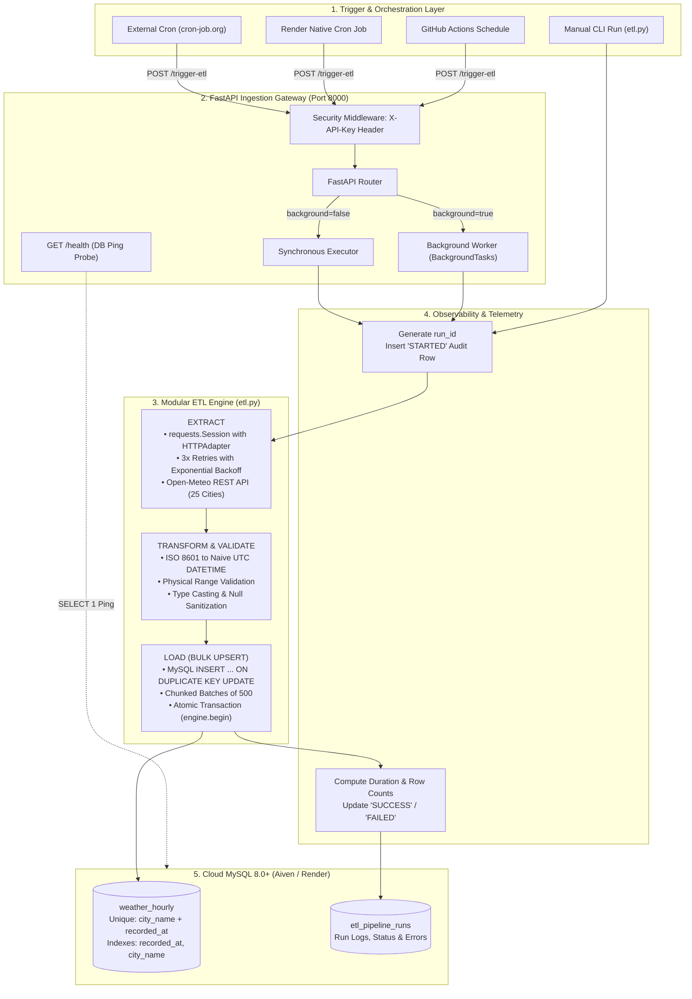
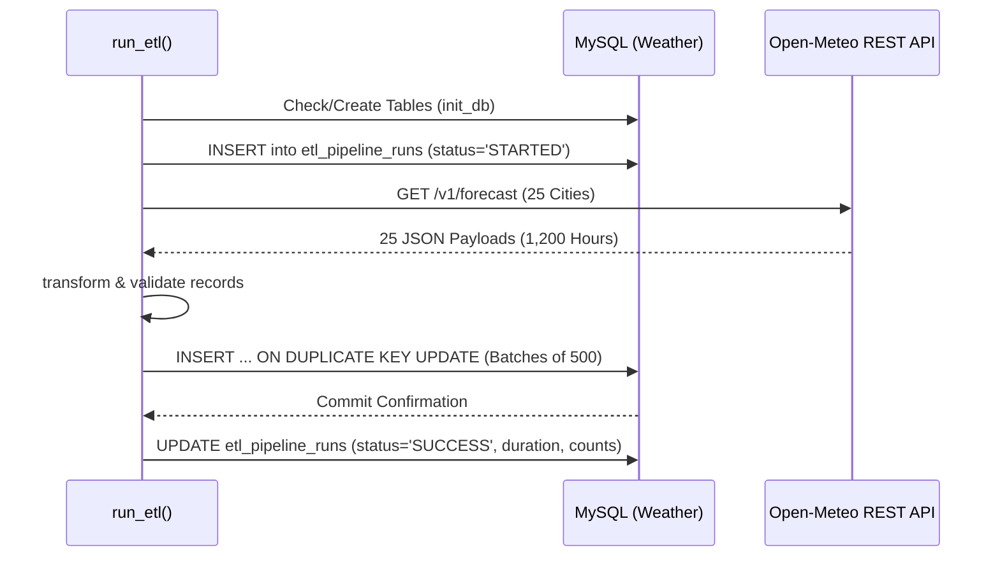

# Open-Meteo Weather ETL Pipeline: Architecture & Engineering Manual

> **Document Version**: 2.0.0  
> **Target Environment**: Python 3.10+ | FastAPI | SQLAlchemy 2.0+ | MySQL 8.0+ (Aiven / Render / Cloud)  
> **Data Source**: Open-Meteo REST API  
> **Status**: Production Ready  

---

## Table of Contents

1. [Executive Summary & Purpose](#1-executive-summary--purpose)
2. [End-to-End Architectural Blueprint](#2-end-to-end-architectural-blueprint)
3. [Deep Dive: In-and-Out Component Mechanics](#3-deep-dive-in-and-out-component-mechanics)
   - [3.1 Configuration Subsystem (`config.py`)](#31-configuration-subsystem-configpy)
   - [3.2 Extraction Engine (`etl.py` - `extract()`)](#32-extraction-engine-etlpy---extract)
   - [3.3 Transformation & Validation Engine (`etl.py` - `transform()`)](#33-transformation--validation-engine-etlpy---transform)
   - [3.4 Incremental Load Engine (`etl.py` - `load()`)](#34-incremental-load-engine-etlpy---load)
   - [3.5 Orchestration & Audit Telemetry (`run_etl()`)](#35-orchestration--audit-telemetry-run_etl)
   - [3.6 FastAPI Automation & Webhook Layer (`main.py`)](#36-fastapi-automation--webhook-layer-mainpy)
4. [Data Dictionary & Database Schema](#4-data-dictionary--database-schema)
5. [Configured Global Cities Catalog (25 Target Cities)](#5-configured-global-cities-catalog-25-target-cities)
6. [Deployment & Cloud Operation Guide](#6-deployment--cloud-operation-guide)
7. [Automated Scheduling Recipes](#7-automated-scheduling-recipes)
8. [Analytical SQL Cookbook](#8-analytical-sql-cookbook)
9. [Failure Modes & Recovery Protocols](#9-failure-modes--recovery-protocols)

---

## 1. Executive Summary & Purpose

The **Open-Meteo Weather ETL Pipeline** is an enterprise-grade, event-driven data pipeline designed to ingest, cleanse, normalize, and incrementally upsert global meteorological observation and forecast data into a cloud-hosted MySQL database.

### Core Objectives
1. **Idempotent Ingestion**: Re-executing the pipeline across identical or overlapping time windows updates existing records in place without creating duplicates or requiring full table truncation.
2. **Resilience & Fault Tolerance**: Mitigate transient network partitions, DNS resolution anomalies, and HTTP rate limits (429/500/502/503/504) through exponential backoff retries and connection pooling.
3. **Data Quality & Integrity**: Validate physical boundary limits for meteorological metrics (temperature, humidity, precipitation) and normalize disparate ISO 8601 timestamps into naive UTC `DATETIME` formats.
4. **Cloud-Native Automation**: Expose a secure, lightweight REST API (`POST /trigger-etl`) capable of being invoked synchronously or dispatched asynchronously by external cron schedulers (e.g., cron-job.org, Render Cron, GitHub Actions).
5. **Observability**: Maintain a persistent audit trail in MySQL (`etl_pipeline_runs`) recording extraction metrics, transformation yields, load latencies, and execution tracebacks.

---

## 2. End-to-End Architectural Blueprint



---

## 3. Deep Dive: In-and-Out Component Mechanics

### 3.1 Configuration Subsystem (`config.py`)

The configuration layer uses `pydantic-settings` (with a fallback to standard `pydantic` and `python-dotenv`) to enforce strong typing and validation on all operational parameters.

#### Key Mechanics:
1. **Dynamic DNS Resolution & Host Fallback**:
   On Windows and certain containerized environments, socket calls using `getaddrinfo` on long cloud hostnames (such as Aiven's `mysql-185c820f-ajin-sql.h.aivencloud.com`) can intermittently throw `[Errno 11001] getaddrinfo failed`.
   [`config.py`](file:///c:/Users/USER/OneDrive/Documents/Antigravity%20Projects/Pipeline%201/config.py) intercepts the hostname in `get_sqlalchemy_database_url()` and pre-resolves it using `socket.gethostbyname()`. If resolution succeeds, it binds directly to the IP address while preserving the SNI context for TLS.
2. **Cloud SSL/TLS Negotiation**:
   Cloud database providers require encrypted transport. PyMySQL expects `connect_args={'ssl': {}}` to negotiate TLS 1.2/1.3 with default CA validation. When `DB_SSL_DISABLED=False`, the configuration dynamically builds the SSL dictionary.
3. **Connection Pooling Parameters**:
   - `pool_size=5`: Dedicated active connections per worker.
   - `max_overflow=10`: Burst buffer during concurrent requests.
   - `pool_recycle=1800`: Recycles connections after 30 minutes to prevent firewalls and cloud proxies from dropping idle TCP connections.
   - `pool_pre_ping=True`: Executes a lightweight ping before connection checkout, purging dead sockets automatically.

---

### 3.2 Extraction Engine (`etl.py` - `extract()`)

The extraction engine fetches raw JSON metrics from the Open-Meteo REST API.

#### Technical Specifications:
- **Endpoint**: `https://api.open-meteo.com/v1/forecast`
- **Request Parameters**:
  ```python
  params = {
      "latitude": city.latitude,
      "longitude": city.longitude,
      "hourly": "temperature_2m,relative_humidity_2m,precipitation",
      "timezone": city.timezone,  # Standardized to 'UTC'
      "past_days": 1,             # Pull previous 24 hours of confirmed readings
      "forecast_days": 1,         # Pull 24 hours of current forecasts
  }
  ```
- **Connection Reuse**: All 25 HTTP requests are executed through a single `requests.Session()` object, reusing TCP handshakes via HTTP Keep-Alive.
- **Retry Mechanics**: Mounts `urllib3.util.Retry` with:
  - `total=3` retries.
  - `backoff_factor=0.5` (delays: 0.5s, 1.0s, 2.0s).
  - `status_forcelist=[429, 500, 502, 503, 504]`.
- **Fault Isolation**: If an individual city fails (e.g., coordinate anomaly or upstream 500), the exception is logged as an error, and the pipeline continues extracting the remaining 24 cities.

---

### 3.3 Transformation & Validation Engine (`etl.py` - `transform()`)

The transformation module converts heterogeneous API payloads into validated, sanitized, relational-ready records.

#### Data Cleansing & Validation Steps:
1. **Array Length Parity Check**:
   The Open-Meteo response structure nests data under `payload['hourly']`. The engine verifies that:
   $$\text{len}(\text{time}) == \text{len}(\text{temperature\_2m}) == \text{len}(\text{relative\_humidity\_2m}) == \text{len}(\text{precipitation})$$
   If any array is misaligned, the payload is rejected immediately to prevent data corruption.
2. **Timestamp Normalization**:
   Open-Meteo outputs ISO 8601 strings (e.g., `"2026-10-24T12:00"` or `"2026-10-24T12:00:00Z"`). The engine parses these via `datetime.fromisoformat()`, converts them to UTC, and strips timezone offsets to create standard naive Python `datetime` objects compatible with MySQL `DATETIME`.
3. **Physical Boundary Validation & Clamping**:
   - **Air Temperature (`temperature_2m`)**: Must be a valid float within $-90.0^\circ\text{C} \le T \le +70.0^\circ\text{C}$. Out-of-bounds readings or missing values are cast to `None` (`NULL`).
   - **Relative Humidity (`relative_humidity_2m`)**: Clamped between $0\% \le H \le 100\%$, rounded to the nearest integer, and stored as `SMALLINT`.
   - **Precipitation (`precipitation`)**: Checked to ensure $P \ge 0.0\text{ mm}$. Negative values are rejected.
4. **Data Dictionary Generation**: Produces a normalized dictionary matching table columns:
   `city_name`, `latitude`, `longitude`, `recorded_at`, `temperature_2m`, `relative_humidity_2m`, `precipitation`.

---

### 3.4 Incremental Load Engine (`etl.py` - `load()`)

The load engine uses an incremental upsert model to eliminate duplicate rows and support idempotent backfills.

#### Upsert Architecture:
1. **Composite Unique Key**:
   The table `weather_hourly` enforces `UNIQUE KEY uq_city_recorded (city_name, recorded_at)`.
2. **SQLAlchemy MySQL Dialect**:
   Rather than performing expensive `SELECT`-then-`INSERT` queries, the pipeline uses SQLAlchemy's compiled MySQL `insert().on_duplicate_key_update()`:
   ```python
   stmt = mysql_insert(weather_hourly_table).values(batch)
   upsert_stmt = stmt.on_duplicate_key_update(
       temperature_2m=stmt.inserted.temperature_2m,
       relative_humidity_2m=stmt.inserted.relative_humidity_2m,
       precipitation=stmt.inserted.precipitation,
       latitude=stmt.inserted.latitude,
       longitude=stmt.inserted.longitude,
       updated_at=func.now(),
   )
   conn.execute(upsert_stmt)
   ```
3. **Batch Chunking**:
   The engine slices records into batches of 500 (`batch_size=500`). For 25 cities ($1,200$ rows), the load executes in 3 bulk network round-trips ($500 + 500 + 200$), preventing MySQL `max_allowed_packet` exhaustion and minimizing lock contention.
4. **Transaction Boundary**:
   Every batch is executed within an atomic transaction context (`with engine.begin() as conn:`), ensuring that failures rollback cleanly.

---

### 3.5 Orchestration & Audit Telemetry (`run_etl()`)

Every pipeline run is tracked in the `etl_pipeline_runs` table:



- **Run ID**: Unique string: `run_YYYYMMDD_HHMMSS_<6-char-hash>` (e.g., `run_20261024_111925_077295`).
- **Telemetry Collected**:
  - `trigger_type`: `manual_cli`, `fastapi_sync`, `fastapi_background`, or `cron`.
  - `records_extracted`: Raw points extracted.
  - `records_transformed`: Clean points produced.
  - `records_loaded`: Total rows upserted.
  - `duration_seconds`: Wall-clock execution time (typically 4–7 seconds for 25 cities).
  - `error_message`: Complete exception traceback if `status == 'FAILED'`.

---

### 3.6 Python Web Application & API Automation Gateway (`main.py` & `web_ui.py`)

The service acts as both a full interactive **Python Web Application** with an on-demand trigger button and an HTTP automation gateway for cloud schedulers.

#### Web Application Features:
- **Graphical Dashboard (`/`)**: High-performance HTML5/CSS/JavaScript web dashboard served directly by FastAPI without third-party web server requirements.
- **On-Demand "Trigger ETL Pipeline" Button**: Enables any user to execute the ETL pipeline with a single click, providing live execution spinner, duration timer, and real-time receipt of records loaded.
- **Live Monitoring Cards**: Real-time counts of total hourly records in `weather_hourly`, active target cities (25), database connection health, and historical runs.
- **Searchable City Explorer**: Real-time filtering across all 25 cities displaying temperatures, humidity, and rainfall.

#### Endpoint Inventory:
| HTTP Verb | Path | Purpose | Query Params / Headers |
|---|---|---|---|
| `GET` | `/` | Web application dashboard (or JSON summary if `Accept: application/json`) | `format: str` |
| `GET` | `/health` | Live connection health probe (`SELECT 1`) | None |
| `POST` | `/web-trigger-etl` | Endpoint called by web dashboard button | `background: bool` |
| `POST` | `/trigger-etl` | Ingests live weather data into MySQL (External Cron) | `background: bool`, `X-API-Key` |
| `GET` | `/etl/summary` | Real-time aggregate counts for dashboard cards | None |
| `GET` | `/etl/runs` | Inspects recent run audit telemetry | `limit: int` (default: 10) |
| `GET` | `/etl/latest` | Returns latest weather observations per city | None |

#### Synchronous vs. Asynchronous Triggering:
- **Synchronous (`background=false`)**:
  Blocks until Extract, Transform, and Load finish. Returns HTTP 200 with full run statistics (`records_loaded`, `duration_seconds`). Ideal for cron jobs and immediate web UI receipt feedback.
- **Asynchronous (`background=true`)**:
  Dispatches the run via FastAPI's `BackgroundTasks` pool and returns HTTP 202 Accepted with a `job_id` within 10 milliseconds. Prevents HTTP gateway timeouts on constrained networks.

---

## 4. Data Dictionary & Database Schema

### Table: `weather_hourly`

| Column | Type | Nullable | Default | Description |
|---|---|---|---|---|
| `id` | `BIGINT` | No | Auto Increment | Primary key surrogate identifier |
| `city_name` | `VARCHAR(64)` | No | None | Standardized city identifier (e.g., `Tokyo`, `London`) |
| `latitude` | `DECIMAL(8, 5)` | No | None | Latitude in decimal degrees ($-90.00000$ to $+90.00000$) |
| `longitude` | `DECIMAL(8, 5)` | No | None | Longitude in decimal degrees ($-180.00000$ to $+180.00000$) |
| `recorded_at` | `DATETIME` | No | None | Observation/forecast timestamp in naive UTC |
| `temperature_2m` | `FLOAT` | Yes | `NULL` | Air temperature at 2 meters in Celsius |
| `relative_humidity_2m`| `SMALLINT` | Yes | `NULL` | Relative humidity percentage ($0$ to $100$) |
| `precipitation` | `FLOAT` | Yes | `NULL` | Total precipitation (rain/snow) in millimeters |
| `extracted_at` | `DATETIME` | No | `CURRENT_TIMESTAMP` | Initial ingestion timestamp |
| `updated_at` | `DATETIME` | No | `CURRENT_TIMESTAMP ON UPDATE` | Last modification timestamp |

#### Constraints & Indexes:
- **`uq_city_recorded`**: `UNIQUE KEY (city_name, recorded_at)` (Enforces idempotency).
- **`idx_weather_recorded_at`**: `INDEX (recorded_at)` (Optimizes time-slice window queries).
- **`idx_weather_city_name`**: `INDEX (city_name)` (Optimizes city filtering).
- **`idx_weather_city_time`**: `INDEX (city_name, recorded_at DESC)` (Optimizes latest-reading lookup).

---

### Table: `etl_pipeline_runs`

| Column | Type | Nullable | Default | Description |
|---|---|---|---|---|
| `id` | `BIGINT` | No | Auto Increment | Audit record primary key |
| `run_id` | `VARCHAR(64)` | No | Unique | Unique identifier for the pipeline run |
| `trigger_type` | `VARCHAR(32)` | No | `'cron'` | Origin: `fastapi_sync`, `fastapi_bg`, `manual_cli` |
| `status` | `VARCHAR(32)` | No | None | Pipeline state: `STARTED`, `SUCCESS`, `FAILED` |
| `cities_count` | `INT` | No | `0` | Number of target cities in this run |
| `records_extracted` | `INT` | No | `0` | Count of raw hourly data points received |
| `records_transformed`| `INT` | No | `0` | Count of validated and cleansed records |
| `records_loaded` | `INT` | No | `0` | Count of rows inserted or updated in MySQL |
| `error_message` | `TEXT` | Yes | `NULL` | Stack trace or exception details on failure |
| `started_at` | `DATETIME` | No | `CURRENT_TIMESTAMP` | Run start timestamp |
| `completed_at` | `DATETIME` | Yes | `NULL` | Run completion timestamp |
| `duration_seconds` | `FLOAT` | Yes | `NULL` | Elapsed wall-clock time in seconds |

---

## 5. Configured Global Cities Catalog (25 Target Cities)

The pipeline is configured with 25 major world cities covering diverse continents, climate zones, and hemispheres:

| # | City | Country | Latitude | Longitude | Timezone | Climate Zone |
|---|---|---|---|---|---|---|
| 1 | **Tokyo** | Japan | `35.6762` | `139.6503` | UTC | Humid Subtropical |
| 2 | **London** | United Kingdom | `51.5074` | `-0.1278` | UTC | Oceanic / Temperate |
| 3 | **New York** | United States | `40.7128` | `-74.0060` | UTC | Humid Continental |
| 4 | **Berlin** | Germany | `52.5200` | `13.4050` | UTC | Continental / Oceanic |
| 5 | **Paris** | France | `48.8566` | `2.3522` | UTC | Western European Oceanic |
| 6 | **Sydney** | Australia | `-33.8688` | `151.2093` | UTC | Humid Subtropical |
| 7 | **Singapore** | Singapore | `1.3521` | `103.8198` | UTC | Tropical Rainforest |
| 8 | **Dubai** | United Arab Emirates | `25.2048` | `55.2708` | UTC | Hot Desert |
| 9 | **Mumbai** | India | `19.0760` | `72.8777` | UTC | Tropical Wet & Dry |
| 10 | **Sao Paulo** | Brazil | `-23.5505` | `-46.6333` | UTC | Monsoon Subtropical |
| 11 | **Toronto** | Canada | `43.6532` | `-79.3832` | UTC | Warm-Summer Continental |
| 12 | **Cairo** | Egypt | `30.0444` | `31.2357` | UTC | Hot Desert |
| 13 | **Seoul** | South Korea | `37.5665` | `126.9780` | UTC | Humid Continental / Monsoon |
| 14 | **Mexico City**| Mexico | `19.4326` | `-99.1332` | UTC | Subtropical Highland |
| 15 | **Johannesburg**| South Africa | `-26.2041` | `28.0473` | UTC | Subtropical Oceanic Highland|
| 16 | **Buenos Aires**| Argentina | `-34.6037` | `-58.3816` | UTC | Humid Subtropical |
| 17 | **Istanbul** | Turkey | `41.0082` | `28.9784` | UTC | Mediterranean / Oceanic |
| 18 | **Bangkok** | Thailand | `13.7563` | `100.5018` | UTC | Tropical Savanna |
| 19 | **Los Angeles**| United States | `34.0522` | `-118.2437` | UTC | Mediterranean |
| 20 | **Rome** | Italy | `41.9028` | `12.4964` | UTC | Mediterranean |
| 21 | **Madrid** | Spain | `40.4168` | `-3.7038` | UTC | Mediterranean Semi-Arid |
| 22 | **Nairobi** | Kenya | `-1.2921` | `36.8219` | UTC | Subtropical Highland |
| 23 | **Jakarta** | Indonesia | `-6.2088` | `106.8456` | UTC | Tropical Monsoon |
| 24 | **Chicago** | United States | `41.8781` | `-87.6298` | UTC | Humid Continental |
| 25 | **Auckland** | New Zealand | `-36.8485` | `174.7633` | UTC | Temperate Maritime |

---

## 6. Deployment & Cloud Operation Guide

### 6.1 Local Development Quickstart

1. **Activate Python Virtual Environment**:
   ```bash
   python -m venv venv
   .\venv\Scripts\Activate.ps1    # On Windows
   # source venv/bin/activate    # On Linux/macOS
   ```
2. **Install Required Packages**:
   ```bash
   pip install -r requirements.txt
   ```
3. **Execute Unit Tests**:
   ```bash
   python tests/run_tests.py
   # Output: Ran 6 tests in 0.263s -> OK
   ```
4. **Run Ingestion via CLI**:
   ```bash
   python etl.py
   ```
5. **Start the API Server**:
   ```bash
   uvicorn main:app --host 0.0.0.0 --port 8000 --reload
   ```

---

### 6.2 Cloud Deployment on Render

#### Option 1: Render Web Service via Git
1. Push repository code to GitHub or GitLab.
2. In the [Render Dashboard](https://dashboard.render.com), click **New +** -> **Web Service**.
3. Select your repository.
4. Set the build parameters:
   - **Runtime**: `Python 3`
   - **Build Command**: `pip install -r requirements.txt`
   - **Start Command**: `uvicorn main:app --host 0.0.0.0 --port $PORT`
   - **Health Check Path**: `/health`
5. Under **Environment Variables**, define:
   ```ini
   ENVIRONMENT=production
   LOG_LEVEL=INFO
   DB_HOST=mysql-185c820f-ajin-sql.h.aivencloud.com
   DB_PORT=26919
   DB_USER=ajin
   DB_PASSWORD=<YOUR_AIVEN_PASSWORD>
   DB_NAME=Weather
   DB_SSL_DISABLED=False
   API_SECRET_KEY=your-secure-random-token
   ```

#### Option 2: Render Blueprint (`render.yaml`)
Deploy using Render's Infrastructure-as-Code feature by committing [`render.yaml`](file:///c:/Users/USER/OneDrive/Documents/Antigravity%20Projects/Pipeline%201/render.yaml) directly. Render will provision the container and environment configurations automatically.

---

## 7. Automated Scheduling Recipes

### Method A: Web Cron via cron-job.org (Free & External)

1. Register at [cron-job.org](https://cron-job.org/).
2. Create a new Cronjob:
   - **Title**: `Hourly Weather Pipeline Ingestion`
   - **URL**: `https://<your-render-service>.onrender.com/trigger-etl`
   - **Schedule**: `0 * * * *` (Every hour on minute 0).
   - **HTTP Method**: `POST`
   - **Headers**:
     - `X-API-Key`: `<YOUR_API_SECRET_KEY>`
     - `Content-Type`: `application/json`
   - **Timeout**: `30 seconds`
3. Save the job. The scheduler will ping your FastAPI endpoint every hour.

---

### Method B: Render Native Cron Job

1. In Render Dashboard, click **New +** -> **Cron Job**.
2. Set **Schedule**: `0 * * * *`.
3. Set **Command**: `python -c "import etl; etl.run_etl('render_cron')"`
4. Link the existing database environment variables.

---

### Method C: GitHub Actions Scheduled Ingestion Workflow

Create `.github/workflows/weather_etl.yml`:

```yaml
name: Hourly Weather ETL Ingestion

on:
  schedule:
    - cron: '0 * * * *'
  workflow_dispatch:

jobs:
  run-pipeline:
    runs-on: ubuntu-latest
    steps:
      - name: Trigger Ingestion Webhook
        run: |
          curl -s -S -X POST "${{ secrets.SERVICE_URL }}/trigger-etl" \
            -H "X-API-Key: ${{ secrets.ETL_SECRET_KEY }}" \
            -H "Content-Type: application/json" \
            --fail
```

---

## 8. Analytical SQL Cookbook

Use these queries in MySQL Workbench or an analytics dashboard to analyze the loaded data:

### 1. View Current Conditions for All 25 Cities
```sql
SELECT 
    w.city_name,
    w.recorded_at,
    w.temperature_2m AS `Temp (°C)`,
    w.relative_humidity_2m AS `Humidity (%)`,
    w.precipitation AS `Precipitation (mm)`,
    w.updated_at
FROM Weather.weather_hourly w
INNER JOIN (
    SELECT city_name, MAX(recorded_at) AS max_time
    FROM Weather.weather_hourly
    GROUP BY city_name
) latest ON w.city_name = latest.city_name AND w.recorded_at = latest.max_time
ORDER BY w.temperature_2m DESC;
```

---

### 2. Daily Summary: Min, Max, Average Temperature & Total Rain
```sql
SELECT 
    city_name,
    DATE(recorded_at) AS observation_date,
    ROUND(AVG(temperature_2m), 1) AS avg_temp_c,
    ROUND(MIN(temperature_2m), 1) AS min_temp_c,
    ROUND(MAX(temperature_2m), 1) AS max_temp_c,
    ROUND(SUM(precipitation), 2) AS total_rain_mm
FROM Weather.weather_hourly
GROUP BY city_name, DATE(recorded_at)
ORDER BY observation_date DESC, city_name ASC;
```

---

### 3. Pipeline Health & Execution Audit
```sql
SELECT 
    run_id,
    trigger_type,
    status,
    cities_count,
    records_extracted,
    records_loaded,
    duration_seconds,
    started_at
FROM Weather.etl_pipeline_runs
ORDER BY started_at DESC
LIMIT 10;
```

---

## 9. Failure Modes & Recovery Protocols

| Scenario | Root Cause | Built-in Mitigation | Operational Action |
|---|---|---|---|
| **API Rate Limit (HTTP 429)** | Exceeded Open-Meteo per-minute request threshold | `urllib3.util.Retry` with exponential backoff factor 0.5 | If persistent, adjust `RETRY_BACKOFF_FACTOR` in `.env` to 1.0 or increase timeout. |
| **DNS Resolution Failure (`Errno 11001`)** | Cloud hostname resolution drop on Windows or container host | `config.py` automatically pre-resolves `DB_HOST` into IP address | Ensure outbound DNS port 53 is accessible. |
| **MySQL Dropped Connection** | Cloud proxy terminating idle TCP connections | `pool_pre_ping=True` and `pool_recycle=1800` | SQLAlchemy handles reconnection automatically on next checkout. |
| **Duplicate Timestamp Ingestion** | Multiple cron jobs triggering simultaneously | `INSERT ... ON DUPLICATE KEY UPDATE` keyed on `(city_name, recorded_at)` | Safe to run repeatedly; data is updated in place with zero row duplication. |
| **Schema Migration / New Column** | Additional weather metrics required (e.g., wind speed) | SQLAlchemy metadata reflections | Add column to `weather_hourly_table` and run `ALTER TABLE weather_hourly ADD COLUMN ...`. |
